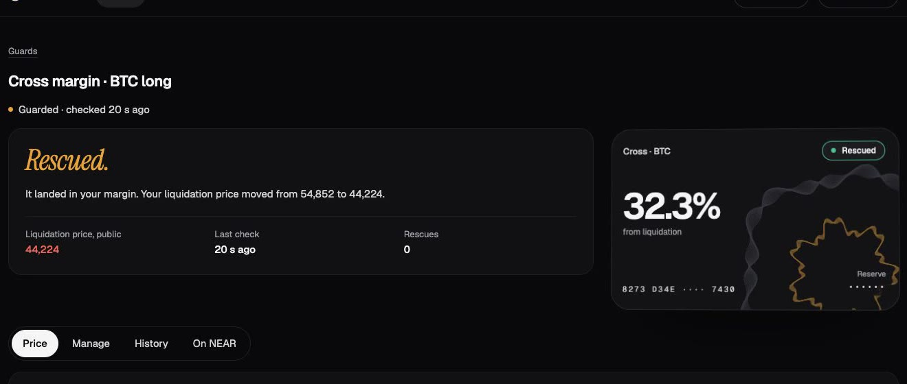
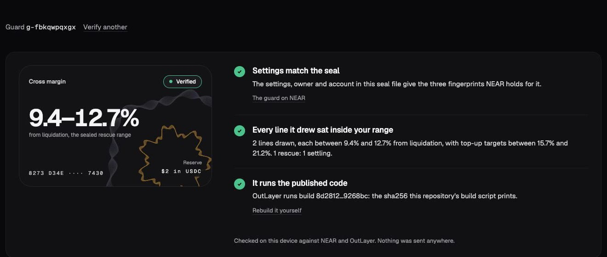
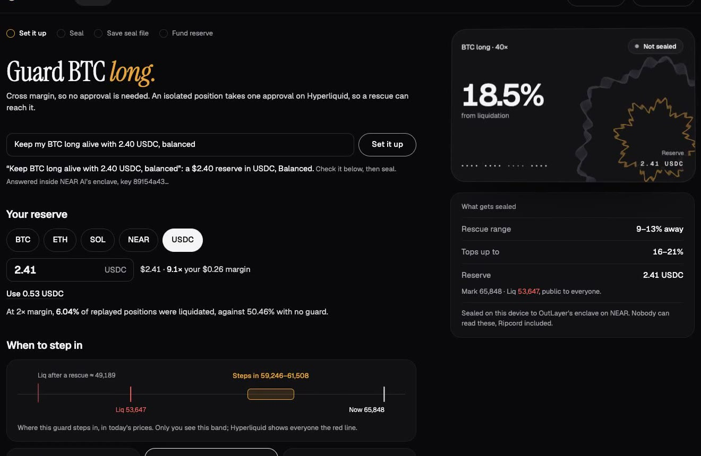

# Ripcord

**Hidden margin for Hyperliquid: a reserve nobody can see lands in your margin before the liquidator does.**

On Hyperliquid every position's liquidation price is public, and traders push the price to those lines. Ripcord guards a position with a reserve whose size and trigger are hidden: the trigger is sealed in a TEE on NEAR, the reserve sits in a private NEAR Intents balance, and when the position nears the hidden line, part of the reserve lands in your Hyperliquid margin in under a minute. It can only ever pay your own account.

Built at NEAR HACKATHON 2026 · live on NEAR mainnet · tracks `defi`, `privacy`, `security`, `agents`, `swarms`

<p>


</p>

## Proof at a glance

- **A real rescue on mainnet, on camera (Nov 14).** We guarded a 40× BTC long on Hyperliquid with our own money, then pulled margin out. The enclave fired; 1.68 USDC landed in the margin 26 s after the rescue started, and the liquidation price moved from 54,852 to 44,224. On NEAR: [guard registered when funded](https://nearblocks.io/txns/DD2eXHvBxKH51S44arfdF6oG4BwukSdN8aYmE5AnUXJR), [rescue recorded](https://nearblocks.io/txns/69KGkypbRxRqKAvqxbeyFAZ5kg5QfswkbPrccKrZPCRk).
- **A trading agent guarded itself on mainnet (Nov 14).** With NEAR AI Cloud and Ripcord's MCP tools, an agent read its risk, sealed a guard, and paid for it in ETH on Base through Aurora and NEAR Intents (exactly 2.00 USDC of reserve). Guarding 2 min 21 s after it started: [registered](https://nearblocks.io/txns/9zt6sSQ3rorxwpgF5emjgE8YizkRJSiM2opVeCDYq3QU), [guarding](https://nearblocks.io/txns/C1zsvDoFF1EDM1oK2S2Y8JxiAiTsipqKcMHZKh7bQL9P), [its wallet on Base](https://basescan.org/address/0x95E97F5c16d00173d62Fe30Ca6d4FAb1dCC8b709).
- **Verifiable.** The registry [`ripcord-registry.near`](https://nearblocks.io/address/ripcord-registry.near) and the checker in OutLayer's TEE run exactly the code in this repo: rebuild them and compare the hashes ([table](#live-on-near-mainnet)), or open `/verify` with a seal file and watch the app check the running build live.
- **Tested blind.** On Nov 3 we sealed six predictions about October 2026 prices before running that data, and committed only their hash. All six held: of 992 simulated positions, 211 were liquidated with no guard and 20 with a hidden reserve the size of the margin. `bash scripts/demo.sh` checks the hash and rescores the result ([evidence](docs/EVIDENCE.md)).
- **Tested.** 372 tests: 33 for the registry contract, 11 for the keeper market, 71 for the enclave (7 of them for keepers), 16 for the Rust rules and replays, 124 shared, 57 web, 24 for the poker and 36 for the agent tools. TypeScript, Rust and a Python reference agree on every hash and guard decision through golden vectors checked in CI.

## Where each track is

| Track | Where to look |
|---|---|
| `defi` | Hidden margin for Hyperliquid perps, with [a real rescue on mainnet](#proof-at-a-glance); reserves funded from Hyperliquid or any chain through NEAR Intents and Aurora ([Built on NEAR](#built-on-near)) |
| `privacy` | The trigger sealed in OutLayer's TEE, the reserve in Confidential Intents, plain words end-to-end encrypted to NEAR AI, and a registry that holds only hashes ([trust model](#trust-model-and-honest-limits)) |
| `security` | Wallet policies that can pay only the owner, a one-signature freeze (NEP-413), and a build anyone can check against the running enclave ([Verify](#try-it-no-funds-needed)) |
| `agents` | MCP tools any agent can use, a trading agent that guarded itself on mainnet, and the risk desk on NEAR's Agent Market ([Try it](#try-it-no-funds-needed)) |
| `swarms` | The open keeper network: independent keepers watch every guard, never see its line, and the one whose check fires a rescue is paid ([keepers](#open-keeper-network)) |

## The problem

- Every Hyperliquid position (size, entry, margin, liquidation price) is public. Heatmap tools draw every trader's liquidation level in real time, and pushing the price into those clusters is a documented pattern: on Oct 10, 2025, $3.21B was liquidated in the peak minute ([Kaiko](https://www.kaiko.com/resources/how-3-21b-vanished-in-60-seconds-october-2025-crypto-crash-explained-through-7-charts)).
- The only defence today is visible: extra USDC on the exchange, which tells a hunter exactly how far to push, or watching the screen all night.
- Existing protection is tied to one venue (Synthetix Wick Insurance) or covers lending only (DeFi Saver). We found none for Hyperliquid.

## How it works, for a trader



1. **Connect** the wallet you trade with, or paste your Hyperliquid address. Nothing is signed: positions are public.
2. **Say what you want**: "keep my SOL long alive through a 25% drop, with BTC". NEAR AI reads it inside its TEE (your words are encrypted in the browser, so Ripcord's server only relays ciphertext) and fills in the reserve and the timing; the amounts are computed by Ripcord's code. Or set them by hand.
3. **Seal.** Your browser encrypts the settings to Ripcord's checker in an OutLayer TEE and keeps a passphrase-locked seal file. Only fingerprints are public.
4. **Fund the reserve**: one wallet signature sends USDC from your own Hyperliquid balance, or send BTC, ETH, SOL, NEAR or USDC from their own chains. It lands in a private NEAR Confidential Intents balance held by the guard's own wallet, whose rules let it pay only your Hyperliquid account. When it arrives, the guard registers on NEAR.
5. **Guarded.** Pokers watch public prices and wake the checker near your line. Inside the TEE it reads your account from Hyperliquid itself, and when you cross the line it sends part of the reserve through NEAR Intents into your perps margin; your liquidation price moves away. The line is redrawn after every rescue, so watching rescues doesn't reveal it.
6. **Settled.** Within 24 hours a rescue is marked Saved (the price passed your old liquidation price: 3 % fee) or Close call (no fee). NEAR records only the hour and a rounded amount.
7. **In your hands.** Every change is one signature from the guard's owner, a key in your seal file or, if you choose, your NEAR wallet: top up the reserve (the amount stays private), change the rescue range (the new one is sealed like the first), freeze the reserve, or close the guard, which sends the rest to your own Hyperliquid account. A NEAR wallet owner can freeze from any device with nothing else. Verify, with the seal file, checks what the guard did.

## Run it

**Needs:** Node 22 or later and git. pnpm 12 comes with Node through corepack (pinned in `package.json`). Optional: Rust (stable) for the contract, enclave and replay tests, and Python 3 for the reference implementation; the demo skips what's missing and says so. No keys and no funds: the demo and the simulation need none.

```sh
git clone https://github.com/Musaga-Technology/Ripcord.git
cd Ripcord
bash scripts/demo.sh     # installs from the lockfile, then every check (list below); exits non-zero on any failure
corepack pnpm dev        # the app at http://localhost:3000, reading NEAR mainnet and Hyperliquid live
```

The same checks one by one:

```sh
corepack pnpm install
corepack pnpm -r test    # TypeScript: shared rules, web, poker, agent tools
cargo test --workspace   # Rust: rules, replays, the enclave, both contracts
corepack pnpm -r build   # typecheck and the production web build
```

Optional keys, in `apps/web/.env.local` (every variable is described in [`.env.example`](.env.example)): `NEARAI_API_KEY` turns on the plain-words set-up; `OUTLAYER_PAYMENT_KEY` and `CHECKER_PROJECT` let the app seal real guards on mainnet; `NEXT_PUBLIC_POKERS` points it at a poker you run with `corepack pnpm --filter @ripcord/poker start`. For agents, `corepack pnpm --filter @ripcord/mcp start` serves the MCP tools.

## Try it (no funds needed)

| Do | See |
|---|---|
| `bash scripts/demo.sh` (needs Node 22; Python 3 and Rust optional) | Every step ✓: Python, TypeScript and Rust agree on every hash and guard decision; the contract, enclave and poker tests; the Oct 10, 2025 crash replay; the sealed holdout rescored; the web tests and production build |
| `corepack pnpm dev`, open http://localhost:3000 | The home page: the real Oct 10, 2025 ETH crash run through the guard's rules, a guarded and an unguarded 10× long; then **Try to hunt it** |
| Open http://localhost:3000/guards and press **Try a simulation** | Example positions and guards with simulated prices and money, a banner on every screen |
| Press **Guard** on SOL. Type a request in "What should this guard do?" (needs `NEARAI_API_KEY` in `apps/web/.env.local`), or use the form | The reserve, its amount and the timing fill in, with a read-back of what was understood |
| Choose a passphrase, press **Seal guard**, save the seal file, approve, then **Send … from Hyperliquid** | The card prints its pattern, the values collapse to `••••••`, a fingerprint appears; after the simulated deposit: **Guarded** |
| Switch the positions to **Hunter's view**, then open the ETH guard: **Try a crash**, and in **Manage** use **Hold to peek** | The hunter sees every liquidation price and "Can't tell" where the guard is; the rescue fires and Hyperliquid's red line slides away while the Now panel says what is happening; holding shows your sealed range |
| Open http://localhost:3000/verify?example | A veil slides off the card and three checks land: the settings match their fingerprints, every drawn line sat inside the sealed range, and OutLayer runs the build `bash checker/build.sh mainnet` prints, read live from NEAR mainnet |
| Open http://localhost:3000/ledger | The registry's totals read from `ripcord-registry.near` in your browser; rescues appear to the hour and rounded, never with an account |
| Leave the simulation and paste any Hyperliquid address | That account's real positions, nearest to liquidation first, each with a **Guard** button (reading needs no signature) |
| Open http://localhost:3000/freeze and connect a NEAR wallet (HOT, Meteor, Intear, MyNearWallet, Ledger…) | The wallet signs one message that is the same on every device; the guards it owns are found by their hashes alone, and **Freeze** sends `freeze_guard` from your own wallet, with no seal file and no Ripcord server |
| `corepack pnpm testnet:registry account`, then `deploy`, then `e2e` | 18 ✓ on NEAR and OutLayer testnet: the registry controls a guard wallet, an unlisted recipient is refused, the owner freezes with a NEP-413 signature, a frozen wallet refuses everything, a replayed signature is refused, unfreeze, a top-up raises the wallet's cap with no amount on chain, a new range swaps the fingerprint, close |
| Point any MCP client at `corepack pnpm --filter @ripcord/mcp start` and ask about a Hyperliquid address | Four read-only tools, live on mainnet: `liquidation_risk` (positions nearest to liquidation first, and what the replays say about guarding the nearest), `replay_odds`, `guard_status` and `ripcord_ledger`, read from `ripcord-registry.near` |
| Set `RIPCORD_APP_URL`, `RIPCORD_POKERS` and `RIPCORD_PASSPHRASE` for that server, and let a trading agent guard itself | `create_guard` → `fund_guard` → `finish_guard`, and `freeze_guard`: the agent seals a guard for its own account on its own machine, pays the reserve in USDC or, with `from: "any"`, in whatever token it holds on whatever chain (an exact-output quote from Aurora's Intents API, routed confidentially through NEAR Intents), and the guard goes on NEAR; the seal file stays on its disk under the operator's passphrase, and no answer carries the guard's range or reserve |
| `corepack pnpm copilot:eval` (with a NEAR AI key) | 16 varied requests, slang, French, Pidgin and an injection attempt among them, through the app's own encrypted path: 64 of 64 fields right |

## Live on NEAR mainnet

| Piece | Where | Check it |
|---|---|---|
| Guard registry contract | [`ripcord-registry.near`](https://nearblocks.io/address/ripcord-registry.near) ([deployed](https://nearblocks.io/txns/Fpm7gnSSZz372vinZxVoryQucoR4W3fKa1WYuzn1nrsm), [upgraded](https://nearblocks.io/txns/3VJK3fShUHikWXPnaoKtbzsoLaNzqgUqjth8ievR5nQK) with top-up and new range, Nov 11) | Code hash `Ep5CwN8XxzQSwiN8mizcYachLyMRhQboCQFjVyPiYnFL`, which `bash contracts/guard-registry/build.sh` prints |
| Checker in OutLayer's TEE | `ripcord-registry.near/checker`, build `8d2812d7…` ([version](https://nearblocks.io/txns/9RKh1L2KYZtPu1zLBPEhSPFhKjQKsVgrrT4MJdBErf3E)) | sha256 `8d2812d7a16b53c8530df004bced560f7d4291fd765a6b627fd1087a619268bc`, which `bash checker/build.sh mainnet` prints; `outlayer.near get_project` → `active_version` |
| The enclave's own NEAR account | [`d09e4db7…`](https://nearblocks.io/address/d09e4db7a197abc0a8126fdf694d3d556fa45f4154b3dc9a491afc6ea3fcfca6), a key only the enclave holds | [Named the registry's only checker](https://nearblocks.io/txns/4eA3AZBesupk9N4LK5Er7vZCCVsMVe4SRhVnxP78Bm8W) |
| Ripcord's fee wallet | An OutLayer custody wallet, NEAR id `7b3d43bb…190f` | Compiled into the checker build, so the attested hash covers it |
| A real rescue | Guard `g-fbkqwpqxgx` on our Hyperliquid test wallet, Nov 14 | [Registered when funded](https://nearblocks.io/txns/DD2eXHvBxKH51S44arfdF6oG4BwukSdN8aYmE5AnUXJR), [first check](https://nearblocks.io/txns/EX5nqVJPDS3zKVLc2nFGaztbmeMmExWaN1vQF5Db1uQ8), [rescue recorded](https://nearblocks.io/txns/69KGkypbRxRqKAvqxbeyFAZ5kg5QfswkbPrccKrZPCRk) |
| An agent's own guard | Guard `g-sok5bicogo`, sealed and paid for by the demo agent, Nov 14 | [Registered](https://nearblocks.io/txns/9zt6sSQ3rorxwpgF5emjgE8YizkRJSiM2opVeCDYq3QU), [guarding](https://nearblocks.io/txns/C1zsvDoFF1EDM1oK2S2Y8JxiAiTsipqKcMHZKh7bQL9P) |

## Built on NEAR

Every row links the code that uses the piece and a test or transaction that proves it ([all evidence](docs/EVIDENCE.md)).

| NEAR piece | What it does in Ripcord | Code | Proof |
|---|---|---|---|
| OutLayer TEE (Intel TDX) | The checker: opens sealed settings, reads Hyperliquid itself, decides and pays. Its keys (an ed25519 key that is its own NEAR account, and sealing keys) exist only inside the TEE | [enclave host](checker/src/main.rs#L34), [sealed vault](checker/src/vault.rs#L9), [signs its own NEAR transactions](checker/src/near_tx.rs#L132), [manifest](checker/manifest.json) | [64 enclave tests](checker/tests), incl. [outputs never carry a setting](checker/tests/create.rs#L169); mainnet build hash above |
| OutLayer custody wallets and policy | One wallet per guard; OutLayer's keystore lets it pay only the owner's Hyperliquid address, capped at one rescue, even if the checker were compromised | [opens the wallet](checker/src/custody.rs#L92), [its policy](checker/src/policy.rs#L15), [registered once the reserve lands](checker/src/actions.rs#L198) | [registered only once funded](checker/tests/create.rs#L257); [the registry transaction carries hashes only](checker/tests/create.rs#L302); [pays only the owner](checker/tests/check.rs#L165); an unlisted recipient refused `403 policy_denied` (EVIDENCE) |
| NEAR Intents · 1Click | Reserve deposits from Hyperliquid or other chains; a rescue is a private withdrawal credited to the Hyperliquid perps balance | [deposit address](checker/src/custody.rs#L148), [withdraw to Hyperliquid](checker/src/custody.rs#L259), [fund from Hyperliquid in one signature](apps/web/lib/wallet.ts#L185) | Mainnet: 4.79 USDC landed 33.6 s after the call ([ARCHITECTURE §2](docs/ARCHITECTURE.md)); [the send matches Hyperliquid's SDK](apps/web/test/wallet.test.ts#L9) |
| Aurora Intents widget (NEAR Intents) | Pay a reserve from any wallet, in any token, on any chain: the swap is routed confidentially through NEAR Intents and delivers exactly the reserve, in USDC, to the guard's own deposit address | [the payment card](apps/web/components/app/PayAnyWallet.tsx#L32), [held at the exact reserve](apps/web/components/app/PayAnyWallet.tsx#L20), [confidential routing](apps/web/components/app/PayAnyWallet.tsx#L75), [an agent pays in any token the same way](services/mcp/src/owner.ts#L239), [the choice beside "From Hyperliquid"](apps/web/lib/assets.ts) | [where a reserve is paid from](apps/web/test/funding.test.ts); [an agent's payment quotes the exact reserve, privately, to the guard's address](services/mcp/test/owner.test.ts#L105); dry quotes on Nov 12: 2.0 USDC delivered exactly to an outside Arbitrum address, public and confidential (EVIDENCE); first real payment, Nov 14: the demo agent paid 0.00111 ETH on Base and its guard received exactly 2.000745 USDC ([registered](https://nearblocks.io/txns/9zt6sSQ3rorxwpgF5emjgE8YizkRJSiM2opVeCDYq3QU)) |
| Confidential Intents | The reserve is a private balance: its size can't be read and rescues can't be linked to it | the same custody calls, all on `/confidential/*` routes | [an outage pauses and never falls back to a public route](checker/tests/check.rs#L244) |
| NEAR contract | Guard registry: hashes of the owner and the account, status, rounded receipts; controller of every guard wallet's policy, so the owner's freeze, top-up and new range all go through it | [`register_guard`](contracts/guard-registry/src/lib.rs#L244), [`record_rescue`](contracts/guard-registry/src/lib.rs#L383), [`top_up`](contracts/guard-registry/src/lib.rs#L471), [`reseal`](contracts/guard-registry/src/lib.rs#L508), [`freeze_guard`](contracts/guard-registry/src/lib.rs#L534), [`close`](contracts/guard-registry/src/lib.rs#L446) | [33 contract tests](contracts/guard-registry/src/tests.rs), incl. [a top-up names no amount](contracts/guard-registry/src/tests.rs#L494); live at `ripcord-registry.near` |
| NEP-413 signatures | The owner key in the seal file signs freezes, top-ups, new ranges and closes; the contract and the enclave check them | [contract](contracts/guard-registry/src/sig.rs#L18), [enclave](checker/src/owner.rs#L45), [top-up and new range in the enclave](checker/src/change.rs#L78), [browser](apps/web/lib/ownerActions.ts#L84) | [a signature works once](contracts/guard-registry/src/tests.rs#L410); [only the owner's key can close](checker/tests/owner.rs#L134); [a close pays the rest to the owner and closes on chain](checker/tests/owner.rs#L143); [a top-up raises the budget and the cap without saying how much](checker/tests/owner.rs#L227); [a new range waits for a landing rescue](checker/tests/owner.rs#L362); [testnet top-up](https://testnet.nearblocks.io/txns/Cy3e59eR5gisyKR5MiR6ZqJyLE4YkR4Va2DV61bEUmKL) and [new range](https://testnet.nearblocks.io/txns/HL4Vp9NwEKjqQQcRhc8baAC9eciqMdhVhP8RUvxjWkv3); [a testnet freeze](https://testnet.nearblocks.io/txns/J6N1R7VZhyZzJoS5fgn4WJ48XqkrQ2He1oFB1nV1qLi9) |
| NEAR AI Cloud | Plain-words set-up: words encrypted in the browser to the model's attested key (E2EE), so Ripcord's server relays only ciphertext; Qwen in NEAR AI's TEE returns intent, Ripcord computes the amounts | [encrypts to the enclave key](apps/web/lib/copilot.ts#L25), [accepts only a report that answers a fresh nonce](apps/web/lib/copilot.ts#L113), [the relay](apps/web/app/api/copilot/route.ts#L60) | [only the enclave key opens a request](apps/web/test/copilot.test.ts#L26); [its answer can't set an address or a cap](apps/web/test/copilot.test.ts#L35); [the reserve is computed, not taken from the model](apps/web/test/copilot.test.ts#L54); 64 of 64 in the [eval](scripts/copilot-eval.ts) |
| NEAR accounts (NEAR Connect) | A NEAR wallet can own a guard: it signs every owner action as NEP-413, makes the owner's salt again on any device, and freezes from `/freeze` with a transaction it sends itself | [the wallet signs and is checked on the device](apps/web/lib/nearWallet.ts#L55), [the salt again on any device](apps/web/lib/nearWallet.ts#L76), [freeze straight to the registry](apps/web/lib/nearWallet.ts#L88), [guards found by owner hash](contracts/guard-registry/src/lib.rs#L675) | [a wallet's signature checks however it is written, only for this registry](apps/web/test/near-wallet.test.ts#L29); [a wallet-owned guard keeps no key in its seal file](apps/web/test/near-wallet.test.ts#L47) |
| Agent Market (market.near.ai) | The risk desk: a worker any person or agent can hire, or call over A2A and pay per call with x402; it answers with the liquidation risk report for the account in the brief, and declines (so the buyer is refunded) when there is none. Its token can't move funds, and it never logs an address | [the work loop](services/mcp/src/desk.ts#L48), [the report](services/mcp/src/risk.ts#L141), [the same report as an MCP tool](services/mcp/src/tools.ts#L57), [an agent guards its own account](services/mcp/src/owner.ts#L139) | [starts, reads the account and delivers](services/mcp/test/desk.test.ts#L50); [never writes an address to its log](services/mcp/test/desk.test.ts#L80); [the MCP tools over a real client](services/mcp/test/tools.test.ts); [an agent's guard is sealed on its machine and only hashes leave](services/mcp/test/owner.test.ts#L64), [its freeze signature passes the registry's check](services/mcp/test/owner.test.ts#L154); the listing opens with the public launch |
| FastFS | Hosts the checker's binary; OutLayer pins it by sha256 | [upload](scripts/near/lib.ts) | The mainnet build at its FastFS URL (EVIDENCE) |

## Open keeper network

A guard is only as fast as whoever asks the enclave to check it. So anyone can run a poker, a "keeper", and name its NEAR account on its checks (`KEEPER_ACCOUNT`). Keepers form a swarm around every guard, and they compete on one thing: being the first to catch a guard in danger.

- **A keeper can only ask.** It sends `check`; the enclave alone decides to rescue, and answers with a bare status. A keeper can't force a rescue, so bounties can't be farmed, and it never learns where the line is.
- **The one that fires the rescue gets paid.** When a keeper's check is the one that fires a rescue, the enclave credits that keeper in the [keeper market](contracts/keeper-market/src/lib.rs), once per rescue, and the keeper claims a fixed bounty from a pool anyone can fund. Only the enclave's own account can credit.
- **More keepers never mean more payments.** The pay-once rescue keys already make two pokers firing the same rescue pay once, and a failed credit never touches the rescue.

On Nov 14 we ran three keepers side by side on mainnet against the two live guards: 18 checks in two minutes, each answered by the enclave with a bare status, never a line (their logs are in the demo video). On mainnet they watch for free; the bounty is paid on testnet until the enclave's keepers build ships on mainnet. In the simulation (`/guards?simulation`, then **Try a crash**), the guard page shows the keepers watching, which one fired the rescue and its bounty, and the rescue history names it. The market is [live on NEAR testnet](https://testnet.nearblocks.io/address/ripcord-keepers-e3d46d7d.testnet), naming the testnet enclave as its only creditor (`corepack pnpm testnet:keepers status` reads it back). The enclave side is a `keepers` feature that the published builds leave off, so `bash checker/build.sh mainnet` still prints `8d2812d7…` and Verify's claim holds; testnet has no route for real rescue money, so the credit path is proven by tests. Proof: [11 contract tests](contracts/keeper-market/src/tests.rs), [7 enclave tests](checker/tests/keepers.rs) (`cargo test -p ripcord-checker --features keepers`), and [the poker names its keeper](services/poker/test/clients.test.ts).

## Trust model and honest limits

See `docs/ARCHITECTURE.md` §2. In short:
- **It can only pay you.** A rescue and a close pay only your own Hyperliquid account: the guard wallet's policy on OutLayer refuses anything else, and the attested code never asks. You can freeze the reserve with one signature.
- **The AI never touches money.** It fills in a form you confirm; the amounts are computed by code, and nothing it says can set an address or a cap ([test](apps/web/test/copilot.test.ts#L35)).
- **Hidden:** your trigger line and your reserve's size; which accounts are guarded (the registry stores only hashes, and receipts show the hour and a rounded amount). If you let your NEAR wallet own the guard, that NEAR account is named on chain when it freezes, tops up or changes the range; your Hyperliquid account still isn't.
- **Not hidden:** your positions and liquidation price (public on Hyperliquid), and the fact that USDC arrived. A reserve sent from Hyperliquid itself is visible there; send it from another chain to keep its size private.
- **Speed:** a rescue lands in under a minute, so a move that crosses your buffer faster than that can still liquidate you. Most rescues end as close calls (77 % on the default setting in the October 2026 replay): the USDC stays yours as margin and you pay only the network fee (about $0.32).
- **When a guard goes on chain:** once its reserve lands, so an unfunded guard costs nothing on NEAR. In the seconds before that, only the attested code can move the money.
- **Isolated positions** need one approval of an agent key held in the guard's wallet. On Hyperliquid an agent can trade but not withdraw or send; Ripcord's code only ever signs "add margin". Revoke it any time.
- **Pasted addresses:** a guard pays only the account it was set up for, so the app asks you to confirm the account is yours.
- **Small remainders:** less than $2 can't be sent back to Hyperliquid (the route's minimum) and stays in the guard's wallet.
- **Third parties:** OutLayer (TEE, keystore, liveness), Confidential Intents operators, 1Click solvers, and Hyperliquid.
- **Known issue: the first mainnet receipt's public amount is 100× too high.** The Nov 14 rescue credited 1.68 USDC, but its public receipt reads 170, and so does the Ledger's "Margin added": Hyperliquid counts USDC in 8 decimals and the running enclave build divides by 10^6. The money moved correctly; only the rounded public figure is off. The fix is one line in `checker/src/check.rs`, but it changes the build hash this README asks you to verify, so it ships with the next enclave release rather than on deadline day.

| Who | Can see | Can't see |
|---|---|---|
| Public and hunters | Positions and liquidation prices (public on Hyperliquid), and that USDC arrived | Your line, your reserve, what's left, or whether you're guarded |
| Ripcord's team | Which accounts are guarded (the pokers need them) | Your line, your target or your reserve |
| OutLayer's operator | Your reserve's balance, and each rescue's amount and destination | Your line and target, sealed in the enclave |
| 1Click | Each swap's amount and destination | Your line, or the rest of the reserve |

## What we hit

Real problems from building on mainnet, and what we did:
- **OutLayer changed its wallet-policy format mid-hackathon** (a version, lock flag and deadline became required). A rerun of our testnet end-to-end test caught every guard registration failing; the contract and enclave now pass both formats.
- **NEAR holds a call's attached gas up front at about 10× the gas price.** Our first mainnet project registration was refused for dipping into the contract's storage deposit, and guard registration attached 200 Tgas against a float of 0.078 NEAR. A registration burns about 11 Tgas, so it now attaches 70.
- **Storage costs 1 NEAR per 100 KB.** NEAR's own sha256 and Binaryen's `wasm-opt` packed the registry 21 % smaller, to 282 KB (2.8 NEAR), with no feature cut; remapped paths make it rebuild byte for byte.
- **The route has a floor.** NEAR Intents carries a rescue to Hyperliquid from $2 ($1 is refused), so a guard tops up at least $2 instead of never firing on a small position.
- **A send from Hyperliquid needs $1 more** than the amount it funds; the app adds it and says so.
- **Testnet has no private route**, so private funding and rescues are tested on mainnet with small real amounts, and the enclave's mock-host tests cover every branch.
- **The enclave declares its network hosts in an attested manifest**, so its NEAR RPC is one the manifest already lists rather than the fastest one.
- **Hyperliquid keeps 10 % of a position's size in Perps before anything can leave.** So moving margin out can never take a 40× position closer than 8.75 % to liquidation, and our live demo sealed its line from a farther distance so the line sat where a trader's own transfers can reach it.
- **The first send to a new Hyperliquid address costs 1 USDC more**, charged to the sender's Spot balance (the "token gas" error). A guard's deposit address is new, so a send from Hyperliquid needs that dollar in Spot.
- **Our test account came up as a unified account mid-take**, where Perps and Spot are one balance and transfers between them disappear. Ripcord reads liquidation prices, which unified accounts still publish, and we switched back to Standard for the demo.

## Prior art

| Project | Difference |
|---|---|
| Chainlink CRE liquidation-protection challenge (Sept 2026) | Private rules for a testnet loan, but each public action reveals the strategy; Ripcord's reserve is unlinkable and its line is redrawn per rescue |
| Synthetix Wick Insurance | A grace period inside one venue; needs the venue to build it |
| DeFi Saver Liquidation Protection | Lending positions, one chain at a time, in public; nothing for perps |
| Liquidation heatmaps (OpenMarket, MMT, Hyperdash) | The hunter's tools; Ripcord is the counter |
| near.com confidential perps | Hide who trades; positions and liquidation prices stay public |

## Business model

Ripcord is paid when it saves you: 3 % of the rescued amount (0.5 % above $50K) when the price later crosses your old liquidation price, recorded on chain, plus $1 a month per guard. A close call costs only the network fee.

Priced on live Hyperliquid positions ($12.0B open interest; method in `docs/EVIDENCE.md`): if every position within 60 % of liquidation were guarded, save fees would be about $11M a year, or $17M with 2× reserves; guarding 5 % of them is about $0.5–0.8M a year. Front ends that embed the guard can share the save fee.

## What's next

- **near.com perps traders.** near.com runs perps on Hyperliquid, so its traders' accounts can be guarded unchanged today, owned by the NEAR wallet they sign in with and funded in NEAR; next is finding their trading account from the near.com sign-in instead of pasting it.
- **Rhea Lending borrowers.** Rhea credits every deposit to its sender today; one small change (a deposit that names the account it credits) lets the same hidden reserve add collateral before a liquidation.
- **A make-good fund:** 10 % of every save fee in a public multisig treasury that pays back a liquidation the guard should have prevented.
- **Hidden stops and a fast lane:** stop-loss sealed in the enclave, never on the public book, and opt-in reduce-only orders for moves faster than a rescue.
- **Agents that pay their own way:** a trading agent sending its guard's deposit with its own wallet tools, so no person steps in between `fund_guard` and `finish_guard`.
- **Keepers on mainnet:** the enclave's keepers build on mainnet, so real rescues pay the keepers that fire them.
- **Mobile wallets** through WalletConnect.

## Repository layout

```
apps/web                  Next.js app: set-up, guard, simulation, Verify, Ledger, and the NEAR AI relay
packages/shared           Types, commitments, guard rules, sealing, owner messages (shared by web and poker)
services/poker            Watches public Hyperliquid prices; wakes the checker near a guard's line
services/mcp              For agents: MCP tools to read risk and to guard an agent's own account, and the risk desk for NEAR's Agent Market
crates/rules              Rust rules shared by the checker and the contract (same vectors as TypeScript)
crates/replay             The crash replay harness and the sealed holdout
contracts/guard-registry  NEAR contract: guard registry and wallet-policy controller
contracts/keeper-market   NEAR contract: credits the keeper whose check fires a rescue, and pays its bounty
checker                   The program in OutLayer's TEE: sealed guards, Hyperliquid reads, rescues, close
scripts                   Reference implementation, testnet and mainnet deploys, replay data, the AI eval
docs                      Architecture and trust model, interfaces (SPEC), design, evidence
```

## Built with

Libraries and tools, as the hackathon rules ask. All code in this repository was written for Ripcord from Oct 30; nothing is copied from earlier projects.

- TypeScript 6, pnpm 12, Node 22; Next.js 16, React 19, Tailwind CSS 4
- `@hot-labs/near-connect` (NEAR Connect: the wallet picker and NEP-413 signing)
- `@noble/hashes`, `@noble/curves`, `@noble/ciphers` (SHA-256, ed25519, X25519, ChaCha20 and XChaCha20-Poly1305 in the browser); `near-api-js` (scripts)
- Rust: `serde`, `serde_json`, `sha2`, `hex`, `base64`, `bs58`; `x25519-dalek`, `hkdf`, `chacha20poly1305`, `ed25519-dalek`; `near-sdk` (contract); `wit-bindgen`, `wasi-http-client`, `wasi` (checker on OutLayer); Binaryen `wasm-opt`
- `@modelcontextprotocol/sdk` and `zod` (the agent tools); `@aurora-is-near/intents-swap-widget` and its EVM adapter (paying from any wallet)
- vitest, ESLint, Prettier, tsx; Python 3 standard library for the reference implementation (`scripts/vectors.py`) and the replay scoring
- Fonts: Geist, Geist Mono

## License

MIT
